# Ledgr

**Track every rupee, just by chatting.**

Ledgr is an Android expense & income tracker built with Flutter. Instead of
filling forms, you type what you spent the way you'd text a friend, in Roman
Urdu or English, and Ledgr turns it into entries.


```
100 ka petrol
100 ka biscuit
aj ke din ka
```

→ two expense entries (**Fuel** Rs 100, **Food & Dining** Rs 100), dated today.

## Screenshots

<table>
  <tr>
    <td>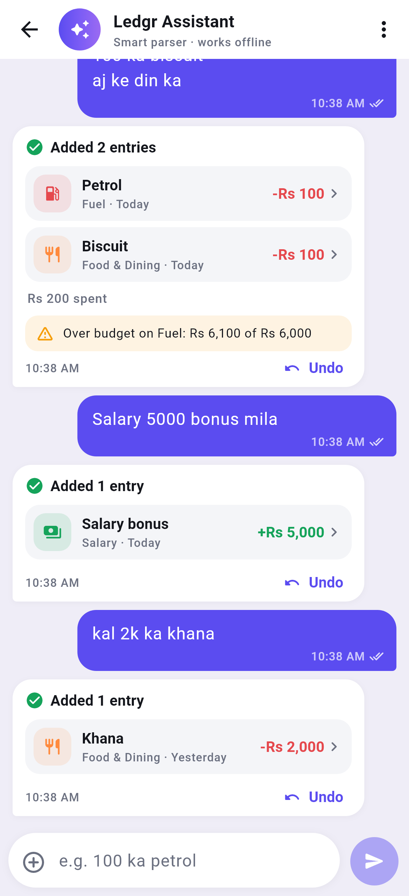</td>
    <td>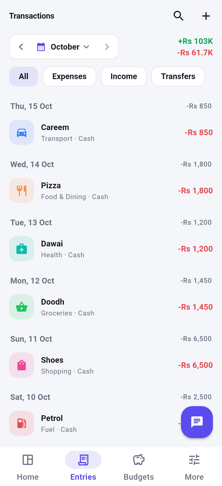</td>
    <td>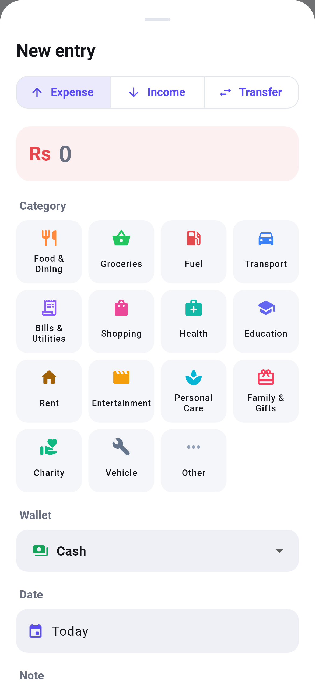</td>
    <td>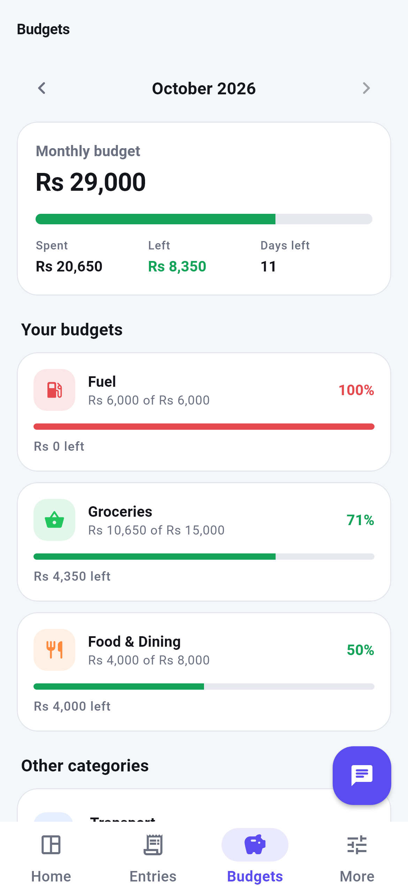</td>
  </tr>
  <tr>
    <td>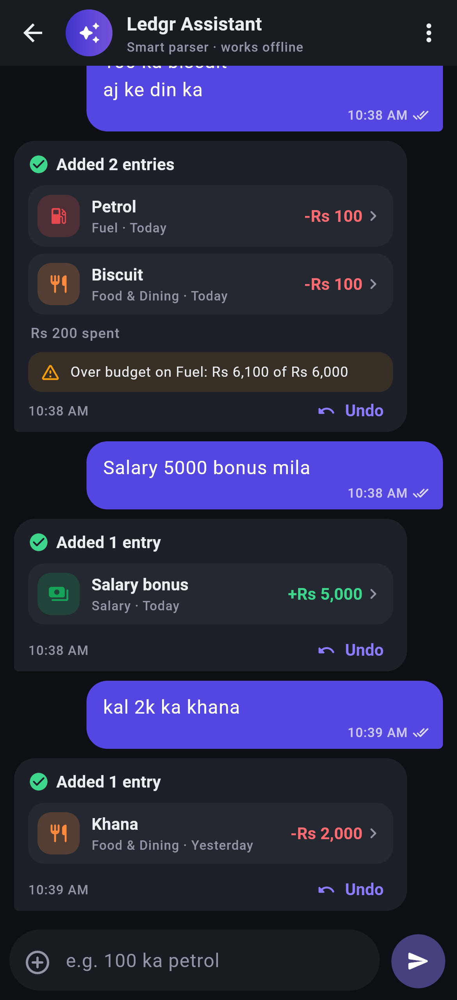</td>
    <td>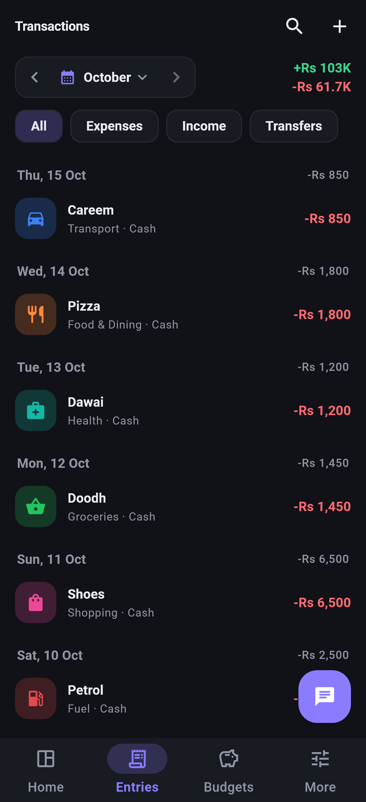</td>
    <td>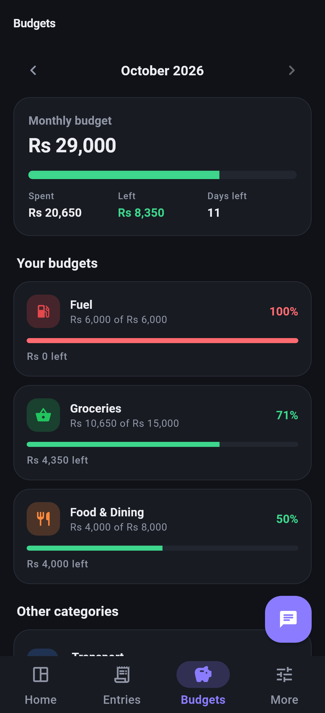</td>
    <td>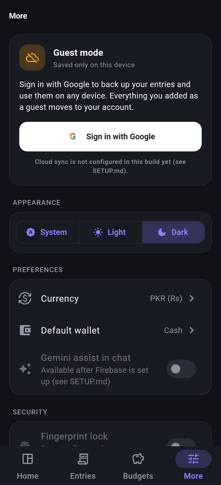</td>
  </tr>
  <tr>
    <td>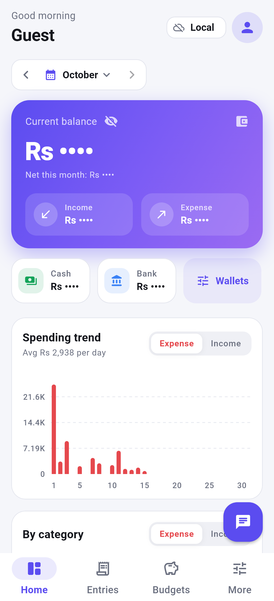</td>
    <td>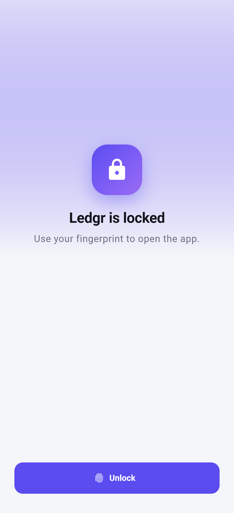</td>
    <td>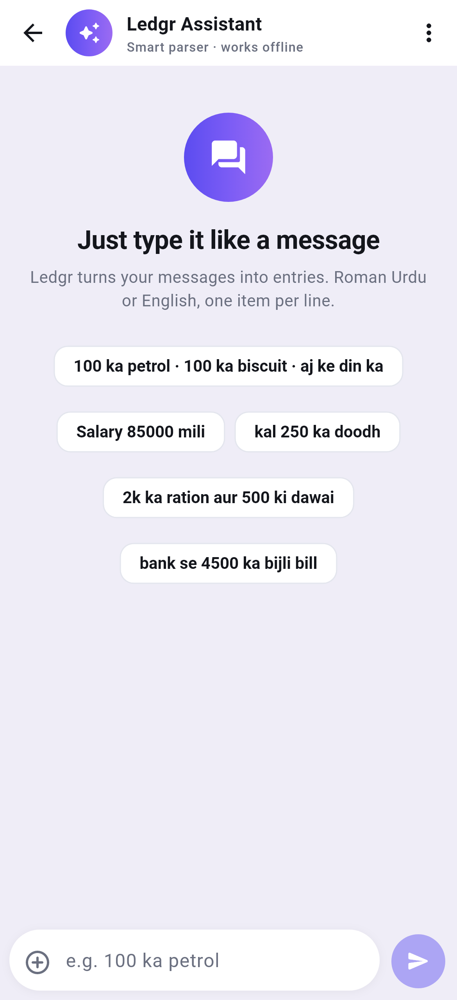</td>
    <td>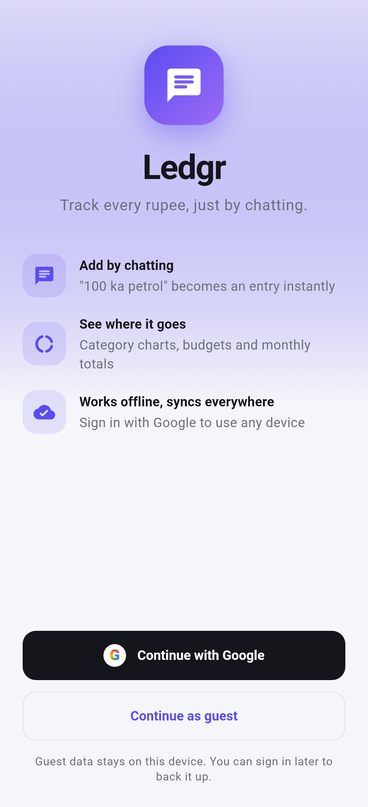</td>
  </tr>
</table>

<details>
<summary>Full dashboard (long screenshot)</summary>
<br>
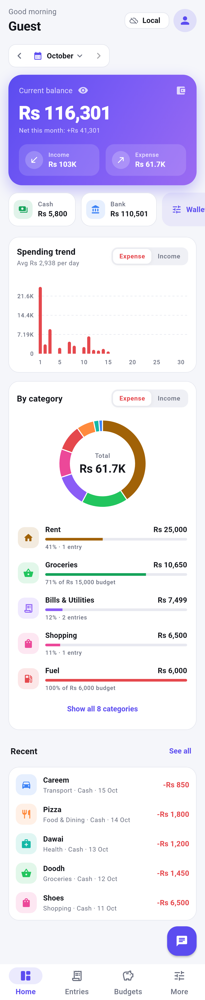
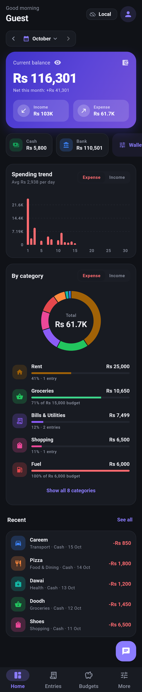
</details>

## Features

- **Chat quick entry.** One item per line, Roman Urdu or English. It
  understands amounts like `2k`, `5 hazar`, `1.5 lakh` and `Rs 1,250`; dates
  like `kal`, `parson`, `3 din pehle` and `15/10`; income words (`mili`,
  `aaye`, `salary`); and wallets (`bank se…`). Entries save immediately, every
  reply has **Undo**, and tapping a card edits it. Ledgr remembers your
  corrections.
- **Hybrid parsing.** A fast offline rule parser runs first. When it is unsure
  and you are online, Gemini (via Firebase AI Logic) takes a turn.
- **Dashboard.** Current balance, income vs expense for any period (day, week,
  month, year, all time or a custom range), wallet balances, a spending trend
  chart and a category donut with budget progress.
- **Multiple wallets** (Cash, Bank, JazzCash…) with transfers between them.
- **Monthly budgets** per category, with warnings right in the chat when you
  get close or go over.
- **Categories** for income and expense, with icons, colours and chat keywords.
- **Export** a PDF report or a CSV (opens in Excel) for any period.
- **Fingerprint lock** (optional, in *More → Security*). Ledgr asks for your
  fingerprint when it opens; your phone's PIN or pattern works as a backup.
- **Hide balances** with the eye button on the dashboard. Balance, income,
  expense and wallet amounts turn into `Rs ••••`, and Ledgr remembers your
  choice.
- **Google sign-in** with offline-first cloud sync, or **continue as guest**
  and keep everything on the phone.
- Light and dark theme.

## Download

Get the latest APK from
**[Releases](https://github.com/hamidraza04321/ledgr/releases/latest)**:

| File | For |
|---|---|
| `Ledgr-phone-arm64.apk` | Android phones (Android 7.0 or newer) |
| `Ledgr-emulator-x86_64.apk` | Android emulator on a PC |

Android will ask you to allow installs from unknown sources the first time.

## Build it yourself

You need the [Flutter SDK](https://docs.flutter.dev/get-started/install)
(3.44 or newer) and the Android SDK.

```bash
git clone https://github.com/hamidraza04321/ledgr.git
cd ledgr
flutter pub get
flutter run                     # phone with USB debugging, or an emulator
```

Release APK for phones:

```bash
flutter build apk --release --target-platform android-arm64
# → build/app/outputs/flutter-apk/app-release.apk
```

> **Windows:** Gradle breaks if the project path contains `&`. Build from a
> path without it. [SETUP.md](SETUP.md#1-build--run-important-folder-name)
> shows how to do that with a junction.

Guest mode works right away. Google sign-in, cloud sync and the Gemini chat
assist need **your own Firebase project**: follow [SETUP.md](SETUP.md)
(about 15 minutes).

## How your data is stored

| Mode | Where data lives | Works offline |
|---|---|---|
| Guest | SQLite on the phone only | Yes |
| Google | SQLite on the phone, synced to Firestore under `users/{uid}` | Yes, syncs when back online |

Signing in moves your guest entries into your account. The
[Firestore rules](firestore.rules) only let each user read and write their own
data.

## Tech stack

| Area | Packages |
|---|---|
| UI & state | Flutter (Material 3), [Riverpod](https://riverpod.dev) |
| Local database | sqflite |
| Charts | fl_chart |
| Sign-in & sync | firebase_auth, google_sign_in, cloud_firestore |
| AI chat assist | firebase_ai (Gemini Flash-Lite), firebase_app_check |
| Export | pdf, share_plus |

## Project layout

```
lib/
  core/        theme, config, formatting, periods, icons
  data/        SQLite schema, models, repositories
  services/    chat parser (offline + AI), sync, auth, export
  providers/   Riverpod state
  features/    screens: dashboard, chat, transactions, budgets,
               categories, wallets, settings, auth, export
test/          parser unit tests, screen tests (+ screenshots in test/goldens)
tool/          configure_firebase.dart (writes the Firebase config files)
```

## Tests

```bash
flutter test
```

To refresh the screenshots in `test/goldens/` (the ones shown above):

```bash
flutter test test/screens_test.dart --dart-define=SCREENSHOTS=true --update-goldens
```
